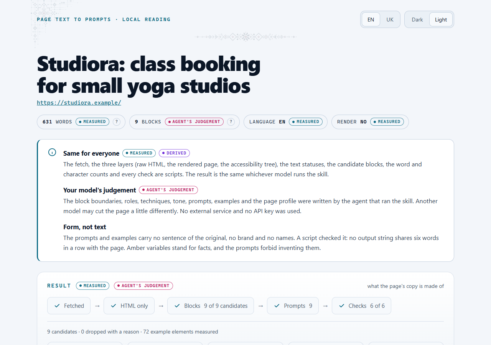
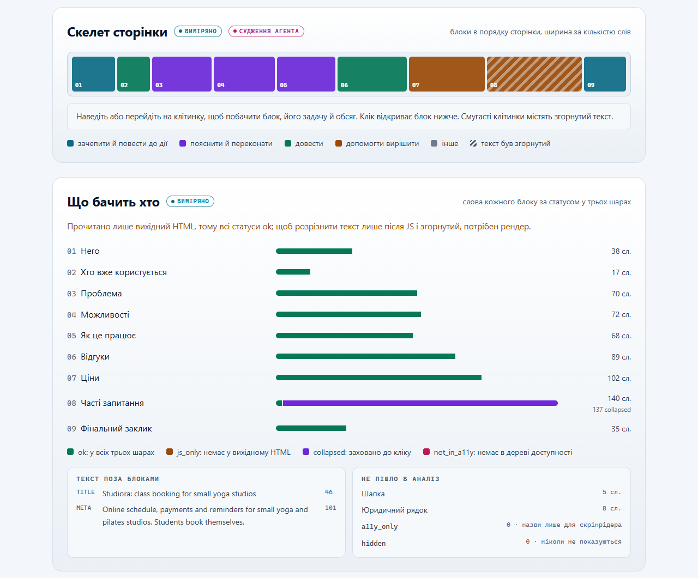
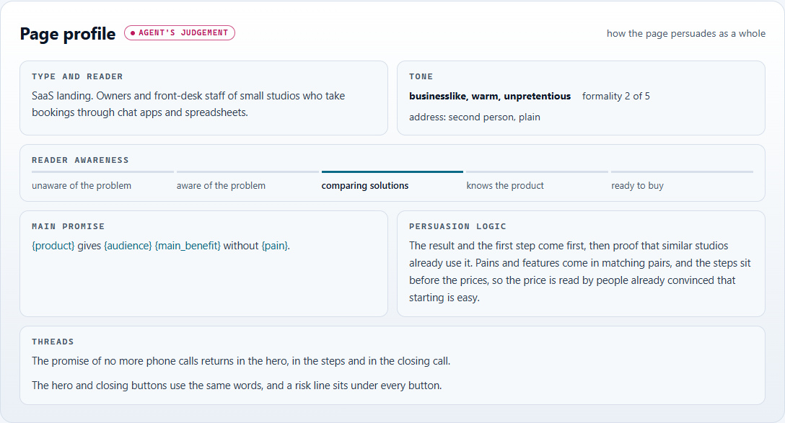
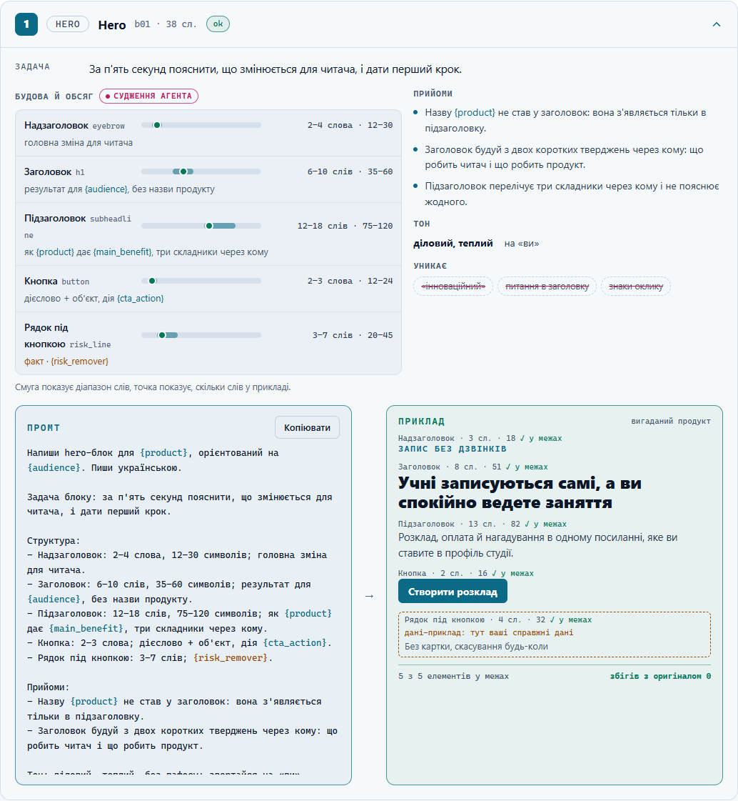
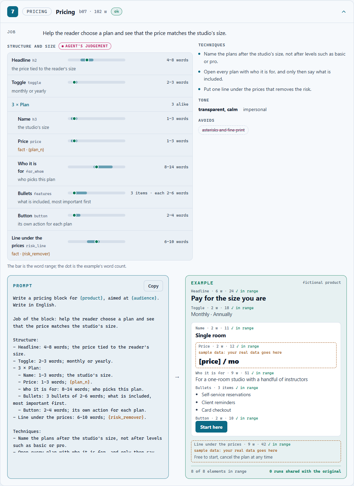
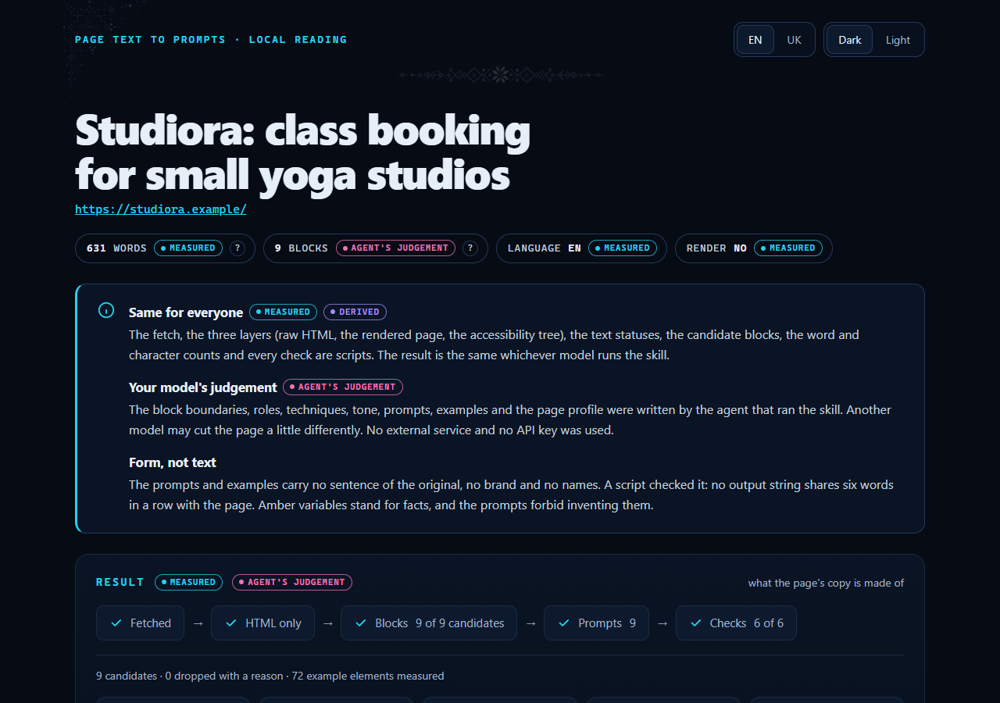

# Page text to prompts

An Agent Skill from [GetLoopLoop](https://www.getlooploop.com) for Claude Code, claude.ai, Codex, opencode and other agents that load `SKILL.md` skills. Version **1.008**.

Give it a URL. It splits the page's copy into blocks (hero, benefits, how it works, testimonials, pricing, FAQ, CTA…) and, for every block, writes what the block does, how it is built (parts, order, words per part, techniques, tone), a reusable prompt that writes the same kind of block for another product, and an example written from that prompt and measured against it. It copies the shape of the text, never the text: a script refuses any result that shares six words in a row with the page or names its brand.

The page is read three ways and compared: the raw HTML, the page rendered in the browser already on the machine (a fresh throwaway profile, desktop 1440 × 900, scrolled, FAQ opened), and its accessibility tree. So the report can say which text appears only after JavaScript, which was folded behind a click, and which exists only for screen readers.

The scripts call no model and no API. The agent running the skill writes only its judgements, in a short `analysis.md` (one line per element: code, word range, what it must contain, an example); the scripts read the page, measure it, derive the character ranges, assemble every prompt and check the result. Prompts and examples are in English unless the user asks for another language.



## The report

The skeleton of the page, each block's width its word count, and what each layer sees of every block:



The page profile: the reader's awareness, the main promise with variables, the persuasion logic and the threads that run through the page:



Every block: its job, its structure with word ranges (the dot is the example's count), the techniques written as instructions, the prompt, and the example written from it, each element measured against its range:



Repeated cards are one group with a count (here three plans), and the example is written for one card; elements that stand for facts (prices, clients, guarantees) are drawn as sample data the user must replace, and the prompt forbids inventing them:



The same report in the dark theme:



Everything the skill writes is in English by default: the report, page-prompts.md, the prompts and the examples. The report also carries a Ukrainian version of its own labels, behind the EN / UK switch in its header; prompts and examples are written in another language only when the user asks for one.

These screenshots are the test fixture (`tests/fixtures/studio.html`, a fictional studio) read from a saved file, so only the HTML layer appears: the report says "HTML only", and the folded FAQ answers are found from the markup. A live URL adds the render and the accessibility tree, and with them the `js_only` and `not_in_a11y` statuses.

## Install

Download `page-text-to-prompts.zip` from the latest release and either upload it to claude.ai (Customize › Skills › Upload a skill) or unpack it into your agent's skills folder (for Claude Code, `~/.claude/skills/`). No `npm install`: `dist/` carries everything. If your agent's terminal cannot reach GitHub, download the zip in a browser and unpack it yourself; the skill itself only needs network access to the page it reads. Node 22 or later; Chrome, Chromium or Edge for the render (`CHROME_PATH` to choose one), and without one only the HTML layer is read.

## Asking your agent

A short request with a clear stop condition and a reply format keeps the agent on the procedure. Copy it and put in your page:

```markdown
## Task
Run the skill `page-text-to-prompts` on 1 page. Write its prompts and report.

## Inputs
- Page: https://example.com/page
- Working folder: ./prompts

## Rules
1. Read SKILL.md first. Follow it exactly.
2. Write every file into the working folder.

## Stop condition
Stop when report.html exists. Show it.

## Reply format
- The report link or path.
- The blocks found, and the 3 prompts most worth reusing.
```

## Develop

```
cd skills/page-text-to-prompts
npm install
node scripts/read.mjs https://example.com/ --out work/page.json   # also writes work/brief.md and the draft work/analysis.md
# the agent fills in work/analysis.md (see SKILL.md)
node scripts/build.mjs work/page.json work/analysis.md --html work/report.html --md work/page-prompts.md --json work/page-prompts.json
npm test          # node:test suite
npm run bundle    # rebuild dist/ after changing scripts/
npm run zip       # dist-release/page-text-to-prompts.zip
```

## Layout

```
skills/page-text-to-prompts/
  SKILL.md                  instructions for the agent
  references/               block types, the variable dictionary, the analysis.json schema
  scripts/read.mjs          step 1: three layers → page.json
  scripts/build.mjs         step 3: five checks → report.html, page-prompts.md, page-prompts.json
  scripts/lib/              the layers, the checks, the report
  dist/                     the same scripts bundled with cheerio: no npm install
  tools/                    the bundler and the zip packer
  tests/                    node:test suite, a fixture page and passing analyses (analysis.md in English and Ukrainian, analysis.json)
```
